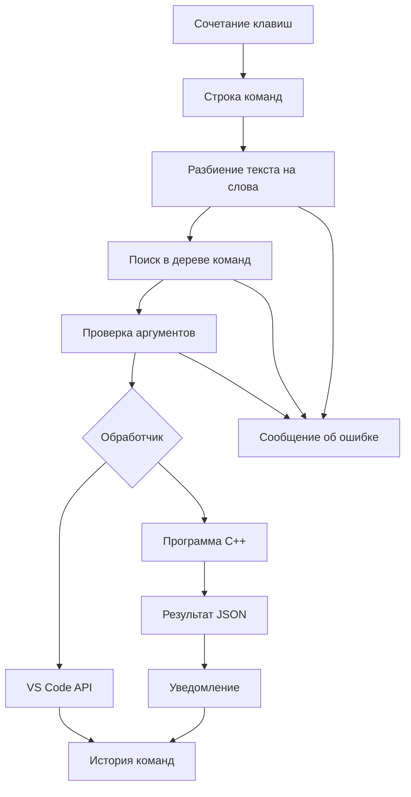

# Документация KeyPilot

## Техническое задание

Разработать расширение для настольного Visual Studio Code,
предоставляющее управление редактором через текстовые команды.

Функциональные требования:

1. Открывать строку команд сочетанием клавиш.
2. Показывать подсказки, соответствующие введённому тексту.
3. Разбирать команды с параметрами и двойными кавычками.
4. Создавать, открывать и сохранять файлы.
5. Показывать терминал.
6. Перемещать курсор к строке.
7. Выделять диапазон строк.
8. Переключать обычный ввод и навигацию h/j/k/l.
9. Сохранять до 30 различных команд в истории проекта.
10. Подсчитывать статистику файла программой на C++.
11. Показывать понятные сообщения об ошибках.
12. Не перезаписывать существующие файлы командой создания.

## Архитектура IDE и подключение расширения

VS Code предоставляет Extension API для взаимодействия
расширений с редактором.

В package.json объявляются:
- точка входа;
- команды;
- назначения клавиш;
- совместимая версия VS Code.

Расширение выполняется в Extension Host.
При вызове объявленной команды VS Code загружает точку входа
и вызывает экспортированную функцию activate.

Функция activate регистрирует обработчики через
vscode.commands.registerCommand.

Ресурсы добавляются в context.subscriptions,
чтобы редактор мог освободить их при отключении расширения.

Встроенные возможности редактора вызываются через VS Code API.
Назначения клавиш зависят от контекста keyPilot.navigation.

## Схема работы

## Модули

- src/extension.js: создание ресурсов и регистрация команд.
- src/commandBar.js: интерфейс, подсказки и маршрутизация.
- src/parser.js: дерево команд, токенизация и обход дерева.
- src/history.js: ограниченный массив истории и сохранение.
- src/modes.js: управление режимами и индикатором.
- src/commands/file.js: создание, открытие, сохранение.
- src/commands/terminal.js: показ терминала.
- src/commands/go.js: проверка строки и перемещение.
- src/commands/select.js: выделение диапазона.
- src/commands/stats.js: запуск C++ и чтение результата.
- native/stats.cpp: чтение файла и подсчёт статистики.

## Структуры данных и алгоритмы

Доступные команды хранятся как дерево объектов.
Конечный узел содержит идентификатор действия и описание.

Ввод разбивается на массив слов.
При разбиении учитывается нахождение внутри двойных кавычек.

Парсер проходит по дереву до конечного узла.
Оставшиеся слова считаются аргументами.

Список подсказок строится рекурсивным обходом дерева.
Введённая строка фильтрует полученный список.

История хранится в массиве.
Повтор команды удаляется со старой позиции и добавляется в начало.
Размер ограничен 30 элементами.
Сохранение выполняется через context.workspaceState.

В C++ используется структура Statistics и буфер 4096 байт.
Файл обрабатывается последовательно за один проход.
Состояние in_word позволяет определять начало нового слова.

## Обмен с C++

JavaScript запускает исполняемый файл через execFile.
Путь анализируемого файла передаётся отдельным аргументом.
Командная оболочка для выполнения не используется.

C++ возвращает JSON через стандартный вывод:

{"lines":2,"words":3,"alnum":12,"bytes":15}

Ошибки передаются через стандартный поток ошибок
и ненулевой код завершения.

JavaScript разбирает JSON, проверяет счётчики
и показывает уведомление.

## Сценарии проверки

Это план проверки. Результаты необходимо отметить
после фактического выполнения.

| Сценарий | Ожидаемый результат |
| --- | --- |
| Открытие KeyPilot | Поле ввода и список команд |
| Ввод file | Только соответствующие подсказки |
| Esc в строке ввода | Закрытие без выполнения |
| terminal | Показ терминала |
| Повтор terminal | Использование активного терминала |
| file new notes.txt | Диалог и создание файла |
| Создание существующего файла | Ошибка без перезаписи |
| file open | Диалог открытия |
| file save | Сохранение |
| go 2 | Переход ко второй строке |
| go 0 | Ошибка номера |
| go abc | Ошибка номера |
| go 999999 | Ошибка выхода за границы |
| select 1 2 | Выделение первых двух строк |
| select 2 1 | Ошибка порядка |
| Незакрытые кавычки | Понятная ошибка |
| mode navigate | Индикатор NAV |
| h/j/k/l | Перемещение курсора |
| i | Возврат INSERT |
| history | Список для повторения |
| Перезапуск в том же проекте | Сохранение истории |
| stats для пустого файла | Все счётчики равны нулю |
| stats для несохранённых изменений | Предложение сохранения |
| Нет C++ программы | Подсказка о сборке |

## Результаты автоматической проверки — 24 октября 2026

C++ модуль успешно собран на macOS через `npm run build:native`.
Команда `npm test` выполняет 7 тестов, все прошли:

- Разбор дерева команд, кавычек и ошибочного ввода.
- Сохранение истории, удаление повторов и ограничение длины.
- Переход к строке, выделение последней строки и проверки границ.
- Создание, защита от перезаписи, открытие и сохранение файлов.
- Создание терминала и повторное использование активного.
- Подсказки, запуск команды и показ ошибки в командной строке.
- Реальная C++ программа: пустой файл, UTF-8, отсутствие конечного перевода
  строки, границы буфера, пути с пробелами и ошибки чтения.

JavaScript проверен с заменой VS Code API; это не проверка
интерфейса и сочетаний клавиш в настоящем редакторе.
Ручные сценарии выше необходимо выполнить перед демонстрацией.
